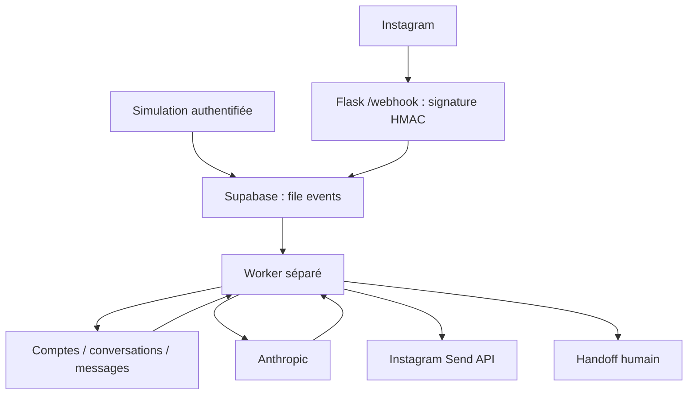

# AGENT-IA — Instagram Business DM Assistant

Backend Flask existant repris avec Anthropic et Supabase/PostgreSQL. Les comptes
business sont isolés par `(account_id, sender_id)`. La mémoire n'est plus stockée
dans Flask : chaque traitement recharge les messages enregistrés dans Supabase.

## État vérifié le 20 octobre 2026

- 14 tests locaux passent, avec dépendances externes simulées.
- Appel réel Anthropic réussi avec le `.env` existant.
- Le projet Supabase est actif ; connexion, schéma et mémoire persistante validés.
- Migrations 001 à 004 appliquées ; deux anciennes conversations importées.
- Mémoire persistante vérifiée avec des traitements dans des processus distincts,
  isolation de deux entreprises pour le même sender et déduplication réelle.
- Webhook et envoi Instagram implémentés. Le token professionnel `alterys.agency`
  est configuré localement et validé par un appel réel à l'API Meta v26.0.
  Le flux réel DM -> webhook -> réponse attend encore un déploiement HTTPS.
- Service Render publié sur `https://agent-instagram-alterys.onrender.com` avec
  le web et le worker dans le même conteneur. Les routes publique, readiness,
  vérification Meta et simulation complète web -> Supabase -> worker -> Anthropic
  ont été validées depuis l'extérieur.
- Application Meta publiée, callback HTTPS vérifié et abonnement Webhooks du
  compte `alterys.agency` activé. Le champ `messages` est abonné en version v26.0.
- Flux réel Instagram validé : deux DMs ont été reçus, mémorisés, traités par
  Anthropic et leurs réponses envoyées avec succès dès la première tentative.
- Modèle par défaut migré vers `claude-sonnet-5` après validation par un appel
  API réel, afin d'éviter la fin de vie annoncée de Sonnet 4.5.
- Politique de confidentialité et instructions de suppression disponibles sur
  `/privacy` et `/data-deletion`, puis enregistrées dans les paramètres Meta.
- La clé Anthropic existante est conservée ; la clé Supabase `anon` utilisée par
  le backend a été remplacée par la clé `sb_secret_` déjà présente dans Supabase,
  sans création ni révocation de clé.
  Elles ont été exposées dans le chat : leur remplacement reste nécessaire pour
  résoudre cette exposition. Aucune clé n'est codée en dur dans les scripts.

## Architecture



## Installation

Python 3.11+ ; le poste actuel utilise Python 3.14.5.

```powershell
cd C:\Users\HP G11\agent-ia
.\venv\Scripts\python.exe -m pip install -r requirements.txt
```

Garder le `.env` existant. Consulter `.env.example` pour les paramètres additionnels.
`SUPABASE_KEY` doit être une clé serveur `service_role` ou son équivalent serveur,
jamais une clé anonyme. `ADMIN_API_KEY` protège les routes de gestion et de simulation.
Une valeur locale a été ajoutée pour l'authentification admin.

## Supabase : migration additive

1. Rendre accessible le projet dont l'URL figure dans `.env` (vérifier le tableau
   de bord : projet actif et URL correcte).
2. Dans SQL Editor, exécuter `migrations/001_agent_ia.sql` : elle crée le schéma
   `agent_ia`, ses quatre tables et les fonctions de file. Elle copie les comptes
   existants en conservant leurs IDs. Les tables `public` restent intactes.
3. Examiner le schéma de `public.conversations`, puis exécuter
   `migrations/002_legacy_history.sql` si les champs existants sont bien
   `account_id`, `sender_id`, `user_message`, `agent_response`, avec éventuellement
   `id` et `created_at`. Les historiques importés ne sont jamais envoyés.
4. Dans les paramètres Data API, ajouter `agent_ia` aux schémas exposés.
   Les tables ont RLS activé et aucun accès accordé à `anon`/`authenticated`.
5. Exécuter `migrations/003_lock_legacy_public.sql` pour activer RLS sur les
   anciennes tables `public.accounts` et `public.conversations`. Le backend utilise
   désormais `agent_ia` ; cette migration ferme seulement l'ancien accès public.
6. Exécuter `migrations/004_instagram_scoped_id.sql` pour enregistrer séparément
   l'identifiant public Instagram et l'identifiant propre à l'application Meta.
7. Exécuter `python check_connections.py` : le contrôle de schéma doit réussir.

La file enregistre les DMs avant acquittement HTTP. Une panne Supabase renvoie 503
afin de permettre une nouvelle livraison. Les événements sont uniques par
conversation, canal et identifiant externe. Chaque conversation est traitée dans
l'ordre ; les autres conversations peuvent progresser indépendamment.

## Lancer localement

Dans deux terminaux depuis le dossier du projet :

```powershell
.\venv\Scripts\waitress-serve.exe --listen=127.0.0.1:10000 app:app
```

```powershell
.\venv\Scripts\python.exe -m services.worker
```

Puis `python tester.py` crée un compte fictif et envoie deux messages dépendants.
`python simuler_dm.py ACCOUNT_ID "Bonjour" --sender marie` utilise le même backend.
La simulation ne prétend jamais avoir envoyé un vrai DM ou un email.
L'ancien POST de simulation `/webhook` est remplacé par `/api/simulate` authentifié.

## Routes

| Route | Accès | Résultat |
|---|---|---|
| GET `/` | Public | Vie du processus |
| GET `/privacy` | Public | Politique de confidentialité pour Meta et les utilisateurs |
| GET `/data-deletion` | Public | Instructions de suppression des données |
| GET `/health/ready` | Public | Disponibilité Supabase/schema |
| POST `/api/setup` | Bearer admin | Création d'un business |
| POST `/api/simulate` | Bearer admin | Mise en file ; 202 avec event_id |
| GET `/api/events/<id>` | Bearer admin | État et réponse |
| POST `/api/conversations/<id>/handoff` | Bearer admin | `{ "human_required": true/false }` |
| GET `/webhook` | Token Meta | Vérification du challenge |
| POST `/webhook` | Signature Meta | DMs officiels |

## Connexion Meta

Cette version utilise **Instagram API with Instagram Login** et
`graph.instagram.com`. Si l'application existante utilise Facebook Login,
adapter le connecteur après vérification de sa configuration plutôt que mélanger
les deux parcours. Voir la [documentation Meta officielle](https://developers.facebook.com/docs/instagram-platform/instagram-api-with-instagram-login/messaging-api)
et la [collection publiée par Meta](https://www.postman.com/meta/instagram/documentation/6yqw8pt/instagram-api).

Configurer le compte professionnel et l'application, autoriser la messagerie,
abonner le compte aux événements `messages`, puis fournir dans l'environnement :
`META_APP_SECRET`, `META_VERIFY_TOKEN`, `META_API_VERSION` et une variable de token
par business, par exemple `INSTAGRAM_TOKEN_ALTERYS`. La version vient du tableau de
bord Meta. Enregistrer `instagram_id` et `instagram_token_env` sur le compte
`agent_ia.accounts` ; ne jamais placer le token dans cette table. Avec Instagram
Login, conserver `user_id` dans `instagram_id` et la valeur `id` renvoyée par
`GET /me` dans `instagram_scoped_id`. Le backend reconnaît les deux dans les
webhooks et utilise l'identifiant applicatif pour envoyer une réponse.

Le callback est `https://agent-instagram-alterys.onrender.com/webhook`. Tester d'abord avec les comptes
autorisés de l'application. Un accès à des utilisateurs externes peut nécessiter
les autorisations et validations Meta correspondantes.

## Robustesse et limites

Anthropic dispose de retries bornés ; la file retente avec délai exponentiel
jusqu'à cinq traitements, puis suspend l'automatisation. Les messages et réponses
générées sont conservés. Le contexte est limité aux 30 derniers messages.
Une demande explicite de personne humaine ou remboursement suspend les réponses ;
il s'agit d'une règle déterministe, pas d'un classifieur IA. Aucun email ou Slack
n'est envoyé automatiquement. La reprise est une action admin explicite.

Un envoi Instagram avec timeout, perte de connexion ou erreur 5xx est considéré
comme ambigu : il passe en `delivery_unknown` avec handoff, sans renvoi aveugle.
Les erreurs HTTP explicites peuvent être retentées. Un worker interrompu pendant
l'envoi produit également un état ambigu après dix minutes. Les messages datant
de plus de 23 heures dans la file ne sont pas envoyés automatiquement. Ne pas
revendiquer une garantie universelle de livraison exactement une fois : Meta ne
fournit pas ici une clé d'idempotence de bout en bout.

Logs sans contenu des DMs, clés ni corps des erreurs fournisseurs. Pas de logs
HTTP détaillés en production. Pas de RAG/vectorisation, réservation, stock réel,
interface SaaS ni tool calling livrés : ces extensions doivent suivre la
validation du flux réel. L'ajout au prompt limite certains comportements mais
ne constitue pas une protection garantie contre toute injection de prompt.

## Déploiement

Le `Dockerfile` lance le web et le worker dans le même petit service via
`start_production.py`. Cette configuration réduit le coût pour la première version.
Si le volume augmente, déployer ensuite deux processus avec le même environnement :

- Web : Dockerfile fourni ou `gunicorn --bind 0.0.0.0:$PORT --workers 2 --timeout 60 app:app`.
- Worker : même image, commande `python -m services.worker`.

Configurer HTTPS, le port fourni par l'hébergeur, les secrets dans son gestionnaire
de variables et la sonde `/health/ready`. Ne pas embarquer `.env` dans l'image.
Le déploiement nécessite le choix et la connexion à un compte d'hébergement ;
aucun service payant ou autorisation Meta n'a été créé automatiquement.

## Validation portfolio

```powershell
.\venv\Scripts\python.exe -m unittest discover -s tests -v
.\venv\Scripts\python.exe check_connections.py --anthropic
.\venv\Scripts\python.exe check_connections.py --instagram
```

`python live_validation.py` effectue explicitement trois appels Anthropic réels
et crée deux comptes marqués Validation A/B. Ce test vérifie la mémoire entre
processus, l'isolation et les doublons dans Supabase ; il n'envoie aucun DM Instagram.

Pour valider la mémoire réellement : envoyer un message, attendre `done`, arrêter
web et worker, redémarrer puis envoyer une question dépendant du premier message.
Refaire avec le même sender sur deux businesses et vérifier leur isolation.
Enfin envoyer un vrai DM Instagram et constater la réponse sur le téléphone.
Tant que ces étapes réelles ne passent pas, présenter le projet comme un backend
préparé et testé localement, avec intégration externe en attente.

## Étapes externes restantes

1. Pour une utilisation commerciale continue, remplacer l'instance Render gratuite
   (qui s'endort après une période d'inactivité) par un service toujours actif.
